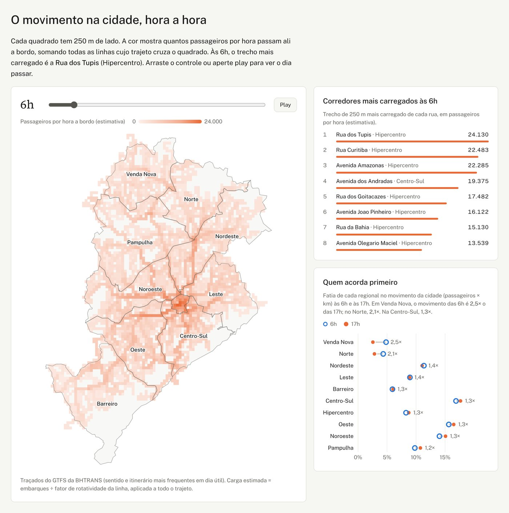
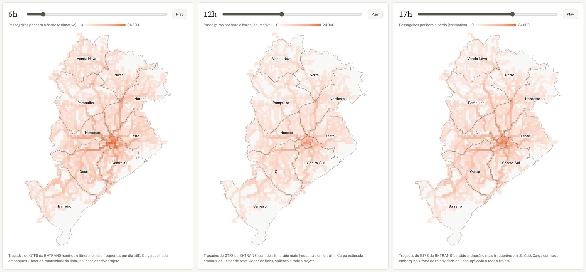
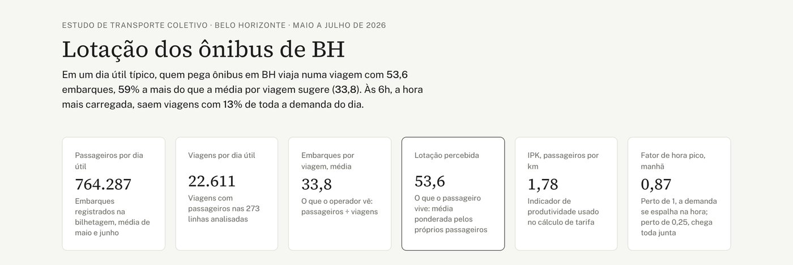
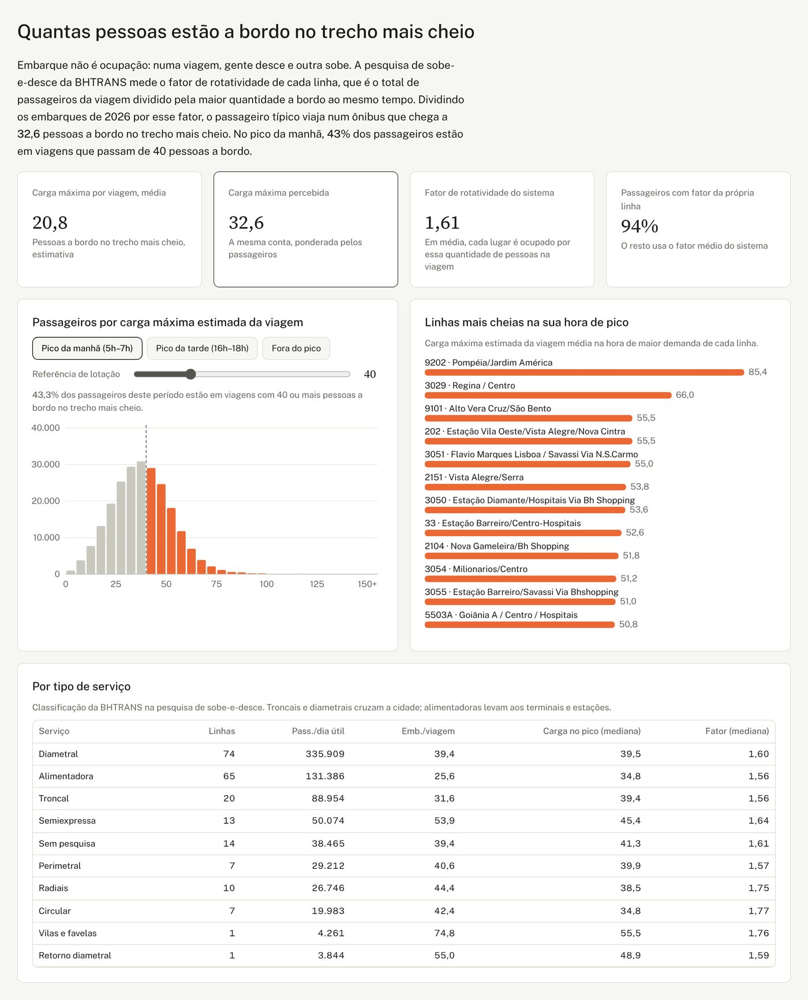
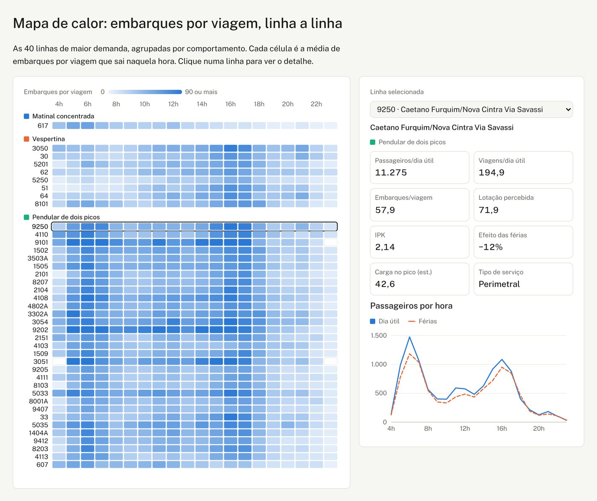
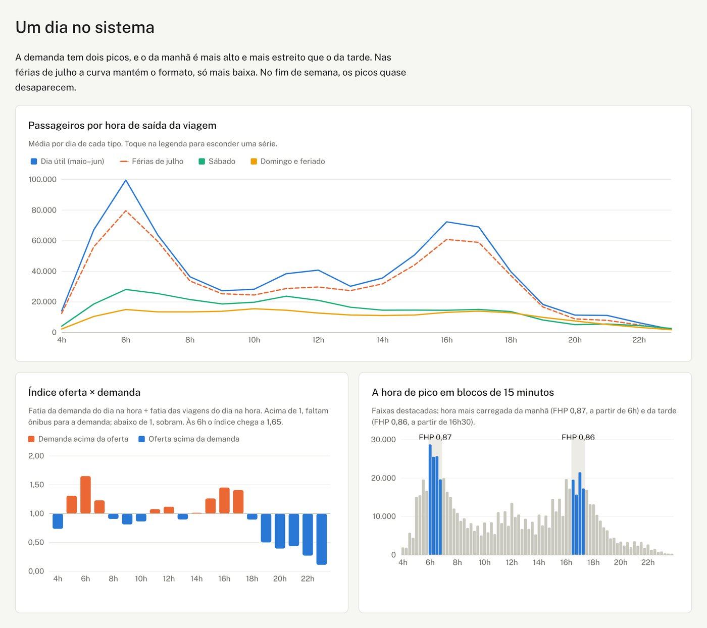

# Lotação dos ônibus de Belo Horizonte

Análise da demanda e da lotação do transporte coletivo por ônibus de Belo Horizonte, por linha, por hora e por região da cidade. O estudo usa só dados abertos da BHTRANS e da Prefeitura de BH: 2,4 milhões de viagens registradas entre maio e julho de 2026, o GTFS da rede e a pesquisa de embarque e desembarque.

**[Abrir o painel interativo](https://SEU-USUARIO.github.io/lotacao-onibus-bh/)** <!-- troque SEU-USUARIO pelo seu usuário do GitHub depois de ativar o GitHub Pages -->



## Perguntas

1. Em que horários e em quais linhas os ônibus enchem?
2. A média de passageiros por viagem conta a história que o passageiro vive?
3. Quais corredores da cidade concentram o movimento, e como isso muda ao longo do dia?
4. Quantas pessoas estão de fato a bordo no trecho mais cheio da viagem?
5. Que comportamentos de demanda existem entre as linhas?

## Principais resultados

| | |
|---|---|
| **764 mil passageiros** por dia útil típico, em **22,6 mil viagens** de 273 linhas | Média de maio e junho de 2026 |
| A média por viagem é **33,8 embarques**, mas o passageiro típico está numa viagem com **53,6** (59% a mais) | 37% das viagens levam até 20 pessoas e carregam só 10% dos passageiros |
| A hora das **6h às 7h** concentra **13%** da demanda do dia | Nessa hora a fatia da demanda é **1,65 vez** a fatia das viagens ofertadas |
| Os corredores mais carregados ficam no Hipercentro: **Rua dos Tupis, Rua Curitiba e Av. Amazonas** | Distribuindo a carga de cada linha pelo seu traçado do GTFS |
| **Venda Nova e Norte acordam primeiro**: o movimento das 6h é **2,5 e 2,1 vezes** o das 17h | No resto da cidade essa razão fica entre 1,2 e 1,4 |
| Nas férias de julho a demanda cai **15%** no dia, mas **27% às 12h** e **29% às 21h** | Horários da troca de turno escolar e das aulas noturnas |
| No pico da manhã, **43%** dos passageiros estão em viagens com **mais de 40 pessoas a bordo** no trecho mais cheio | Estimativa com o fator de rotatividade da pesquisa de sobe-e-desce |
| As linhas se dividem em **três comportamentos**: matinal concentrada (45), vespertina (24) e pendular de dois picos (143) | k-means sobre o formato da curva horária |



## Métricas

| Métrica | Fórmula | Para que serve |
|---|---|---|
| Embarques por viagem | Σ passageiros ÷ nº de viagens | Carga média do ponto de vista do operador |
| Lotação percebida | Σ passageiros² ÷ Σ passageiros | Média ponderada pelos próprios passageiros: a viagem que a pessoa típica pega |
| IPK | Σ passageiros ÷ Σ km percorridos | Produtividade, usada no cálculo de tarifa |
| Fator de hora pico (FHP) | volume da hora ÷ (4 × maior volume de 15 min) | Perto de 1, a demanda se espalha na hora; perto de 0,25, chega toda junta |
| Índice oferta × demanda | % da demanda do dia na hora ÷ % das viagens do dia na hora | Acima de 1, faltam ônibus para a demanda daquela hora |
| Variabilidade no pico | desvio-padrão ÷ média dos embarques na hora de pico, entre dias úteis | Separa lotação previsível de irregularidade |
| Fator de rotatividade | Σ passageiros da viagem ÷ Σ maior carga a bordo | Quantas pessoas, em média, passam por cada lugar do ônibus numa viagem |
| Carga máxima estimada | embarques ÷ fator de rotatividade da linha e sentido | Pessoas a bordo no trecho mais cheio |
| Calor do mapa | Σ carga por hora das linhas cujo traçado cruza o quadrado de 250 m | Corredores mais carregados da cidade |

## O painel

O painel em [`docs/`](docs/) é uma página estática (HTML, D3 e Canvas) que lê os JSON de `docs/data/`. Ele tem:

- indicadores do sistema e o mapa de calor da cidade com controle de hora e botão de play;
- curvas de passageiros por hora em dia útil, férias, sábado e domingo, o índice oferta × demanda e o FHP em blocos de 15 minutos;
- a distribuição de passageiros por faixa de carga, com uma referência de lotação ajustável;
- os três comportamentos de linha, o mapa de calor linha × hora e o detalhe de cada linha;
- o efeito das férias por hora, um calendário de demanda e uma tabela com todas as linhas, com busca e ordenação.

| | |
|---|---|
|  |  |
|  |  |

## Dados

Todos os dados são abertos, com licença Creative Commons Atribuição, e vêm do [Portal de Dados Abertos da PBH](https://dados.pbh.gov.br). Os arquivos brutos não estão no repositório (somam centenas de MB). Veja em [`data/raw/README.md`](data/raw/README.md) como baixar cada um.

| Base | Uso |
|---|---|
| [Mapa de Controle Operacional (MCO)](https://ckan.pbh.gov.br/dataset/mapa-de-controle-operacional-mco-consolidado-a-partir-de-abril-de-2022), maio a julho de 2026 | Uma linha por viagem: linha, sentido, horário, extensão e total de usuários da bilhetagem |
| [GTFS da BHTRANS](https://ckan.pbh.gov.br/dataset/gtfs) | Nome das linhas, traçados (`shapes.txt`) e paradas |
| [Pesquisa de embarque e desembarque](https://ckan.pbh.gov.br/dataset/dados-das-pesquisas-de-embarque-e-desembarque-de-passageiros-do-transporte-coletivo) | Fator de rotatividade por linha e sentido (2008 a 2018) |
| [Região Administrativa (Regional)](https://ckan.pbh.gov.br/dataset/regiao-administrativa) | Limites das regionais, em vigor desde fevereiro de 2025 |

Os resultados processados, já agregados, estão em [`data/processed/`](data/processed/).

## Como reproduzir

Requer Python 3.11 ou mais novo.

```bash
git clone https://github.com/SEU-USUARIO/lotacao-onibus-bh.git
cd lotacao-onibus-bh
pip install -r requirements.txt
# baixe os arquivos listados em data/raw/README.md para data/raw/
./run_pipeline.sh
```

O pipeline leva menos de um minuto e tem quatro etapas:

| Etapa | O que faz |
|---|---|
| `src/01_preparar_mco.py` | Lê os três CSVs mensais do MCO e junta as viagens |
| `src/02_metricas.py` | Filtra as viagens com passageiros e calcula os indicadores do sistema, por hora e por linha, as faixas de carga, o calendário e os comportamentos de linha (k-means) |
| `src/03_mapa_ocupacao.py` | Aplica o fator de rotatividade, projeta os traçados do GTFS em UTM 23S e soma a carga numa grade de 250 m; acrescenta nome e tipo de serviço às linhas |
| `src/04_publicar.py` | Copia os JSON de `data/processed/` para `docs/data/`, de onde o painel lê |

Para ver o painel no seu computador, rode `python -m http.server` dentro de `docs/` e abra `http://localhost:8000`.

### Publicar no GitHub Pages

Em **Settings → Pages**, escolha **Deploy from a branch**, a branch `main` e a pasta `/docs`. Depois de alguns minutos o painel fica em `https://SEU-USUARIO.github.io/lotacao-onibus-bh/`.

## Estrutura

```
lotacao-onibus-bh/
├── data/
│   ├── raw/          # dados brutos (não versionados), veja o README da pasta
│   ├── interim/      # arquivos intermediários (não versionados)
│   └── processed/    # resultados agregados em JSON
├── docs/             # painel publicado no GitHub Pages
│   ├── index.html
│   ├── dash-shim.js  # carrega os JSON e redesenha os gráficos
│   ├── data/
│   └── img/
├── src/              # pipeline em Python
├── requirements.txt
└── run_pipeline.sh
```

## Decisões e limitações

- **Linhas excluídas.** Saíram 21 linhas com mais da metade das viagens zeradas. São as que embarcam passageiros dentro das estações do BRT MOVE e do BHBUS, que o MCO não registra por viagem. Por isso os corredores das avenidas Antônio Carlos e Cristiano Machado aparecem menos carregados do que são.
- **Embarque não é ocupação.** O MCO conta quem passou pela catraca, não quantas pessoas estavam a bordo ao mesmo tempo. A carga máxima estimada corrige isso com o fator de rotatividade, mas o fator vem de pesquisas feitas entre 2008 e 2018. Para 6% dos passageiros, de linhas sem pesquisa, usei o fator médio do sistema.
- **O mapa é um teto.** A carga de cada viagem é aplicada a todo o traçado, como se o ônibus estivesse no trecho mais cheio do começo ao fim. O mapa serve para comparar lugares e horas, não como contagem exata.
- **Horário.** É o de saída da viagem no ponto de controle, não o do embarque de cada pessoa.
- **Dia útil típico.** São os 39 dias úteis normais de maio e junho. Feriados, pontes, o jogo do Brasil na Copa e as férias de julho entram só nas comparações.
- **Capacidade dos veículos.** A base não informa o modelo do ônibus de cada viagem, então o painel não diz se a viagem estava acima da capacidade. A referência de lotação do gráfico de ocupação é ajustável por isso.

## Próximos passos

- Aplicar a mesma metodologia a Curitiba quando a URBS publicar a bilhetagem por viagem (hoje o portal de dados abertos de Curitiba só traz GTFS, posição dos veículos e tabelas horárias).
- Estimar a carga por trecho da linha, cruzando a bilhetagem com a posição dos veículos, em vez de supor carga uniforme no traçado.

## Tecnologias

Python (pandas, NumPy, scikit-learn, pyproj, shapely) para o tratamento e a análise; D3.js e Canvas para a visualização; GitHub Pages para a publicação.

## Autor

**Vicente André**, Ciência da Computação, PUCPR.

## Licença

Código sob a licença MIT (veja [`LICENSE`](LICENSE)). Dados: BHTRANS / Prefeitura de Belo Horizonte, Portal de Dados Abertos, licença Creative Commons Atribuição (CC-BY).
